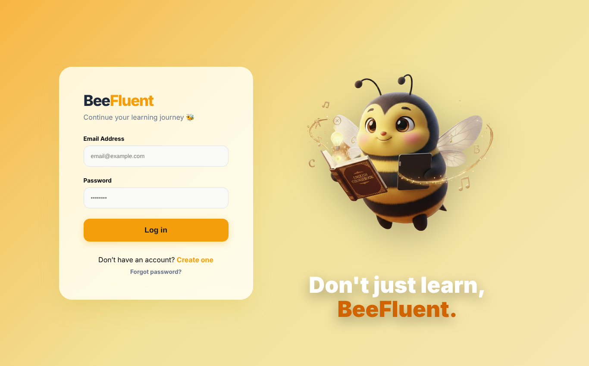
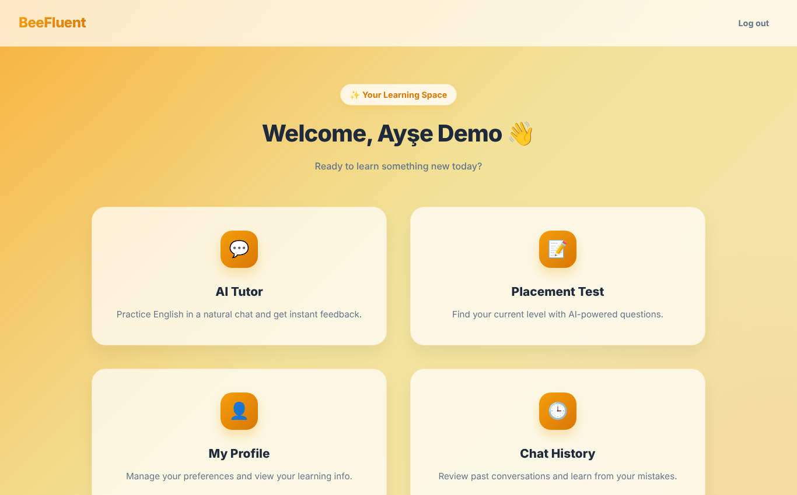
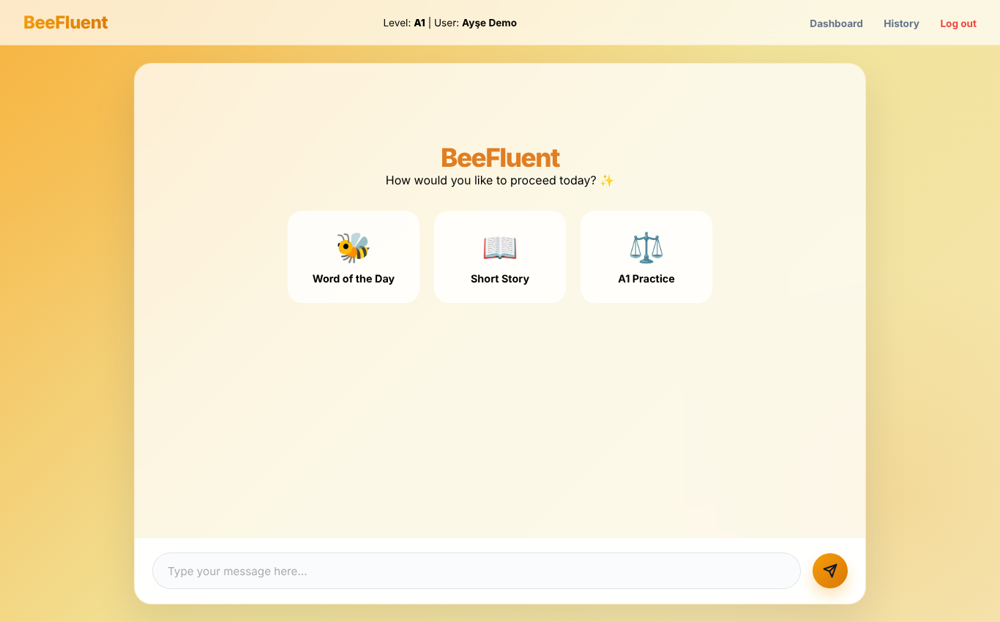
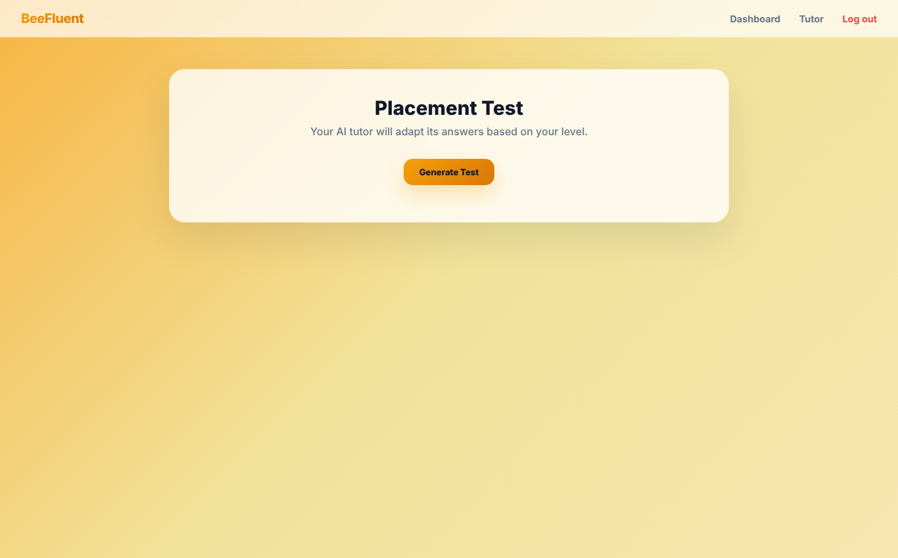
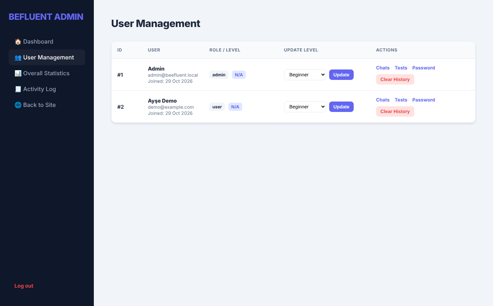

# 🐝 BeeFluent — AI English Tutoring Platform

A web platform for practicing English with an AI tutor. Learners take an AI-generated placement test, get a level, then chat with a tutor that adapts its answers to that level. Admins can manage users and review chats, test results and statistics.

Team project. **My role: backend development**, including the PHP application logic, database layer and AI integration.



## Features

**Learners**
- Register, log in and reset a password
- **AI placement test:** questions generated by the AI, scored automatically, and the learner's level saved (Beginner / Intermediate / Advanced)
- **AI chat tutor** that adapts to the learner's level, with quick-start modes: *Word of the Day*, *Short Story*, and level practice
- Chat history saved in sessions, so learners can review past conversations
- Profile with avatar, plus a reset to retake the placement test

**Admin panel**
- User management: change levels, reset passwords, clear history
- View any user's chats and test results
- Overall statistics (users, chats, average test score)
- Activity log of admin actions with IP and user agent

## Screenshots

| Dashboard | AI tutor |
|---|---|
|  |  |
| **Placement test** | **Admin – users** |
|  |  |

## Tech stack

PHP 8 · MySQL (mysqli, prepared statements) · JavaScript · HTML/CSS · Groq API (Llama 3.3 70B)

## Run it locally

```bash
mysql -u root < database/schema.sql       # creates the ai_tutor database + a demo admin
export GROQ_API_KEY="your-groq-key"       # free key at console.groq.com
php -S 127.0.0.1:8080
```

Open `http://127.0.0.1:8080/login.php`.

**Demo admin:** `admin@beefluent.local` / `admin123`. Change it before deploying.

The chat tutor and placement test need `GROQ_API_KEY`. Everything else works without it.

### Configuration

| Variable | Default |
|---|---|
| `GROQ_API_KEY` | *(required for AI features)* |
| `DB_HOST` | `127.0.0.1` |
| `DB_USER` / `DB_PASS` | `root` / *(empty)* |
| `DB_NAME` | `ai_tutor` |

## Project structure

```
├── login.php · register.php · forgot_password.php · reset_password.php
├── dashboard.php · placement.php · chat.php · chat_session.php · history.php · profile.php
├── api/        # ai_chat, placement_generate, placement_submit, chat_history
├── admin/      # Users, chats, tests, stats, activity log, password reset
├── inc/        # Config, DB connection, repositories, auth guard
├── assets/     # CSS, JS, images
└── database/schema.sql
```
